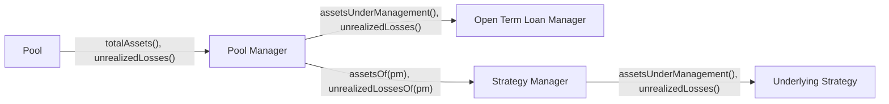

# Pool Accounting

## Total Pool Value (`totalAssets`)

The Pool Manager computes `totalAssets` as the Pool's cash, plus the value of its Open Term Loan Manager, plus its share of each Strategy Manager it funds:

$$
\begin{align} \nonumber totalAssets = cash + assetsUnderManagement_{openTermLoanManager} + \sum{assetsOf_{strategyManagers}} \end{align}
$$

For the [Open Term Loan Manager](../strategies/open-term-loans/open-term-loan-manager.md) the Pool Manager reads `assetsUnderManagement()`. For a [Strategy Manager](../strategies/strategy-manager.md), which several Pools share, it reads `assetsOf(poolManager)`, the Pool's share of the Strategy Manager's total assets in proportion to the shares the Pool Manager holds.

The Open Term Loan Manager's value is:

$$
\begin{align} \nonumber assetsUnderManagement = \sum\Big({outstandingPrincipal_{loan}} + {outstandingInterest_{loan}}\Big) \end{align}
$$

where:

$$
\begin{align} \nonumber outstandingInterest(t) = accountedInterest + issuanceRate \times (t - domainStart) \end{align}
$$

## Unrealized Losses

`unrealizedLosses` is a paper loss: value the Pool expects to lose but has not yet written off. The Pool Manager sums each position's unrealized loss and caps the total at `totalAssets`:

$$
\begin{align} \nonumber unrealizedLosses = \min\Big(unrealizedLosses_{openTermLoanManager} + \sum{unrealizedLossesOf_{strategyManagers}},\ totalAssets\Big) \end{align}
$$

Two events raise it:

* The Pool Delegate or Governor impairs a loan on the Open Term Loan Manager, which adds the loan's principal and the interest accrued so far. See [Impairments](../strategies/open-term-loans/impairments.md).
* An Underlying Strategy records an impairment. Each Strategy Manager funding it reports the Pool's pro-rata share of that loss through `unrealizedLossesOf(poolManager)`.

While `unrealizedLosses` is above zero the Pool prices withdrawals at `totalAssets - unrealizedLosses` and deposits at `totalAssets`. This stops Lenders exiting ahead of a loss and stops new Lenders capturing the jump in value when an impairment is removed. [Exchange Rates](exchange-rates.md) explains the two rates and works through examples.
