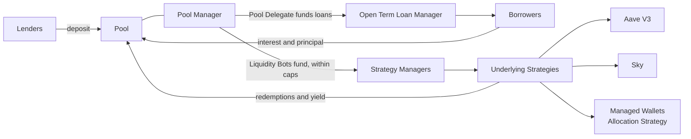

# How Maple Works

Maple is an onchain asset manager. Lenders deposit into a Pool, and the Pool puts that capital to work in open-term loans to institutional borrowers and in shared yield strategies on underlying protocols such as Aave V3 and Sky.

## Lenders

Lenders deposit a Pool's asset, such as USDC, and receive ERC-4626 shares. Shares grow in value as loans pay interest and strategies earn yield. To exit, a lender requests a redemption and the Pool's Withdrawal Manager pays requests in order as liquidity allows. See [Pool](../pools/pools.md) and [Withdrawal Manager](../pools/withdrawal-manager.md).

## Borrowers

Borrowers are institutions that Maple approves in Globals. Each loan is its own Open Term Loan contract that fixes the principal, interest rate, payment interval and fee rates. The Pool Delegate funds the loan from the Pool through the Open Term Loan Manager. The borrower pays interest every interval until it repays the principal or the Pool Delegate calls it. See [Open Term Loans](../strategies/open-term-loans/README.md).

## Strategies

A Pool can also allocate capital to a shared strategy. A strategy is two contracts. The Strategy Manager tracks how much each Pool owns, and several Pools can fund it at once. The Underlying Strategy deploys that capital to one underlying protocol: Aave V3, Sky's sUSDS, or Maple-operated Managed Wallets through the Allocation Strategy. The Pool Delegate sets a cap per strategy, and Maple's Liquidity Bots move capital within those caps. See [How Pools Allocate Capital](../strategies/how-pools-allocate-capital.md).

## Flow of Funds

Interest and strategy yield return to the Pool net of fees. Loan fees go to the Pool Delegate and the Maple Treasury, and strategy fees go to the Strategy Delegate and the Maple Treasury. See [Fees](fees.md).
