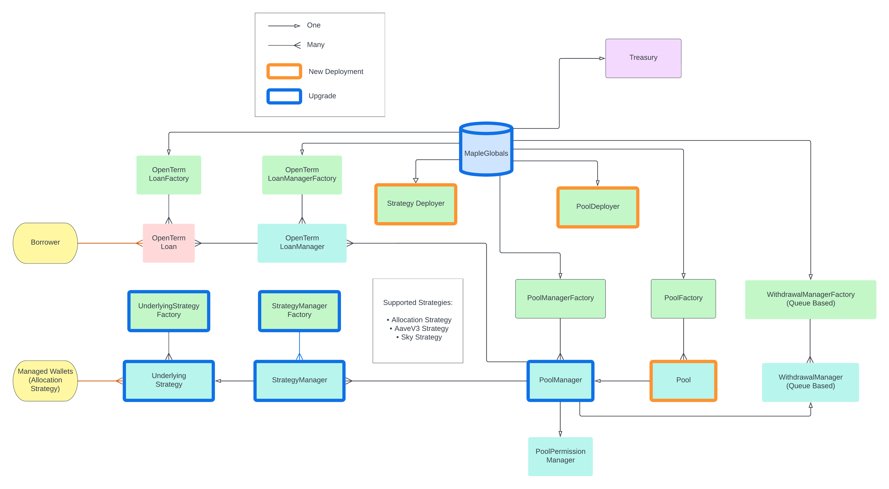
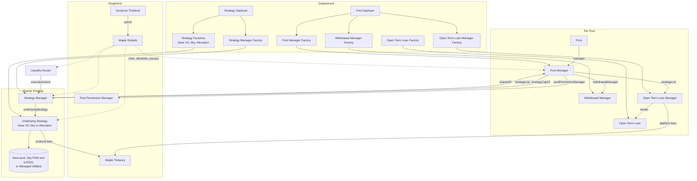

# Smart Contract Architecture

Maple v7 splits lender-facing contracts, per-pool administration, loans and shared strategies into small contracts that find each other through Globals. This page shows how they connect and what each one holds.

## Pool

`MaplePool` is the ERC-4626 vault lenders interact with, and the only contract they need. It is an ERC-20 with ERC-2612 permit. It holds the Pool's idle asset balance and the lender shares, and it delegates every decision to its `manager`, the Pool Manager. Each state-changing call first asks `PoolManager.canCall()` whether the caller has permission, and `totalAssets()` and `unrealizedLosses()` come from the Pool Manager. The Pool is not upgradeable, which is why the logic lives elsewhere. `withdraw()` and `requestWithdraw()` are disabled, so lenders exit through `requestRedeem()` and `redeem()`. See [Pool](../pools/pools.md).

## Pool Manager

`MaplePoolManager` (v5.0.0) has a one-to-one relationship with its Pool and holds the Pool's administrative state: `poolDelegate`, `liquidityCap`, `delegateManagementFeeRate`, `withdrawalManager`, `poolPermissionManager` and `strategyList`. The list holds two kinds of entry, Open Term Loan Managers flagged in `isStrategy` and shared Strategy Managers flagged in `isStrategyManager`, each with a `strategyCapOf` limit.

The Pool Manager computes `totalAssets()` as the Pool's balance plus each loan manager's `assetsUnderManagement()` and each Strategy Manager's `assetsOf(poolManager)`. It moves capital out of the Pool only through `requestFunds(destination, amount)`, which a loan manager or Strategy Manager calls and which reverts if the caller's exposure would exceed its cap. After configuration, only the Governor can add a strategy, and only the Operational Admin can remove a Strategy Manager, once the Pool's position in it is zero. See [Pool Manager](../pools/pool-manager.md).

## Open Term Loan Manager and Loans

v7 supports one loan type, the open-term loan. `MapleLoanManager` is attached to a Pool Manager through `addStrategy()` and aggregates loan accounting for that Pool: `principalOut`, `accountedInterest`, `issuanceRate` and `unrealizedLosses`. When the Pool Delegate calls `fund(loan)`, the loan manager calls `requestFunds()` on the Pool Manager and the Pool transfers principal to the loan.

Each `MapleLoan` is the agreement between one borrower and the Pool. It stores `borrower`, `lender` (the loan manager), `fundsAsset`, `principal`, the interest and fee rates, `paymentInterval`, `gracePeriod` and `noticePeriod`. On each payment the borrower pays interest and service fees to the loan manager, which splits them between the Pool, the Pool Delegate and the Treasury. See [Open Term Loans](../strategies/open-term-loans/README.md).

## Strategy Managers and Underlying Strategies

A shared strategy is a pair of contracts deployed together. `MapleStrategyManager` (v1.0.0) accounts for which Pool owns what: `sharesOf` and `pendingSharesOf` per Pool Manager, `totalShares`, `poolManagerCapOf`, `strategyLiquidityCap`, `strategyDelegate` and its one `underlyingStrategy`. Several Pools can fund one Strategy Manager, and it never holds assets. On `fundStrategyManager()` it calls `requestFunds()` so the Pool sends assets straight to the Underlying Strategy, then calls `fundUnderlyingStrategy()` and mints shares to the Pool Manager. On `processRedemption()` it burns shares and calls `withdrawFromUnderlyingStrategy()`, which pays the Pool directly. Shares are not tokens and cannot be transferred.

The Underlying Strategy talks to one underlying protocol and knows nothing about Pools. It stores `strategyManager`, `fundsAsset`, `impairedAssets` and the two fee rates, and it reports `assetsUnderManagement()`, `availableToWithdraw()` and `unrealizedLosses()` to the Strategy Manager. v7 ships three implementations, each with its own factory registered under `UNDERLYING_STRATEGY_FACTORY`:

* `MapleAaveV3Strategy` supplies to an Aave V3 pool and holds the aToken.
* `MapleSkyStrategy` swaps through the Sky PSM and holds sUSDS.
* `MapleAllocationStrategy` holds cash as `recordedAssets` and lets approved Managed Wallets deploy it.

See [Strategy Manager](../strategies/strategy-manager.md), [Aave V3 Strategy](../strategies/aave-v3-strategy/README.md), [Sky Strategy](../strategies/sky-strategy/README.md) and [Allocation Strategy](../strategies/allocation-strategy/README.md).

## Liquidity Router

`MapleLiquidityRouter` is a small non-upgradeable contract with an immutable `globals` address. A bot registered as `LIQUIDITY_ROUTER_BOT` calls `executeActions(actions, deadline)` with an ordered list of fund, request, cancel and process actions across any Strategy Managers. The router checks each Strategy Manager against `STRATEGY_MANAGER_FACTORY` and runs the actions in order, and the whole batch reverts if one fails. Strategy Managers accept its calls because it is registered as `LIQUIDITY_ROUTER`. It holds no assets and grants no permission beyond what the Strategy Manager already gives Operators. See [Liquidity Router](../strategies/liquidity-router.md).

## Withdrawal Manager

Most Pool capital is deployed at any time, so lenders cannot always redeem instantly. `MapleWithdrawalManager` (queue, v2.0.1) is deployed one per Pool and stores `pool`, `poolManager` and a first-in, first-out `queue` of withdrawal requests. `Pool.requestRedeem()` escrows shares and adds a request. A `WITHDRAWAL_REDEEMER` bot, the Pool Delegate or the Operational Admin calls `processRedemptions()` to pay requests in order from the Pool's liquidity, and lenders flagged for manual withdrawal redeem processed shares themselves. See [Withdrawal Manager](../pools/withdrawal-manager.md).

## Maple Globals

`MapleGlobals` is the singleton every other contract reads. It stores the protocol roles (`governor`, `securityAdmin`, `operationalAdmin`, `mapleTreasury`), the `poolDelegates` and `strategyDelegates` registries that bind each delegate to one owned contract, the `isInstanceOf` allowlists for factories, bots, routers, underlying protocols and Managed Wallets, `bootstrapMint` per asset, platform fee rates per Pool Manager, pause flags, and timelock windows for scheduled calls. The Governor is the `GovernorTimelock` contract, so protocol-level changes wait for its delay, and the Treasury receives all protocol fees. See [Maple Globals](../singletons/globals.md), [Governor Timelock](../singletons/governor-timelock.md) and [Maple Treasury](../singletons/maple-treasury.md).

## Factories and Deployers

Every upgradeable contract is a proxy created by a `MapleProxyFactory`, which also manages implementation versions and upgrade paths under Governor control. Globals allowlists each factory under a key such as `POOL_MANAGER_FACTORY`, `WITHDRAWAL_MANAGER_QUEUE_FACTORY`, `STRATEGY_FACTORY` for loan managers, `LOAN_FACTORY`, `STRATEGY_MANAGER_FACTORY` and `UNDERLYING_STRATEGY_FACTORY`, so contracts can verify on-chain that a counterparty came from a vetted factory.

Two deployers wire new instances together in one transaction. `MaplePoolDeployer` (v5.0.0) creates the Pool Manager and Pool, the Withdrawal Manager and loan managers, attaches Strategy Managers with caps, and calls `completeConfiguration()`. `MapleStrategyDeployer` (v1.0.0) creates a Strategy Manager and its Underlying Strategy at predicted addresses so each references the other, pulls the bootstrap deposit from the Strategy Delegate and completes configuration. Globals then activates the new Pool Manager or Strategy Manager. See [Creating a Pool](../pools/pool-creation.md), [Strategy Deployer](../strategies/strategy-deployer.md) and [Proxies and Upgradeability](proxies-and-upgradeability.md).
