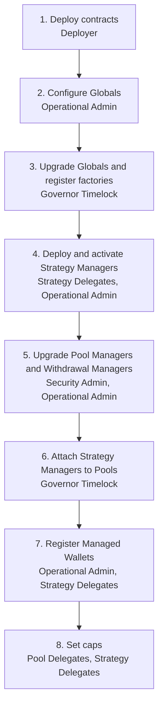

# November 2026 Release: Deployment and Upgrade

This page describes the procedure that deploys the November 2026 release contracts and upgrades five live Pools to use shared strategies. It follows the deployment script (`scripts/ModularReleaseDeployment.s.sol`) and the fork test that runs the full procedure against mainnet state (`tests/protocol-upgrade/modular-release/`) in the `maple-core-v2-private` repository. For what the release contains, see [November 2026 Release: What Changed](november-2026-release-what-changed.md).

## Actors

| Actor | Role in the procedure |
| --- | --- |
| Deployer | An EOA that deploys every new contract. Its nonce determines the addresses, so it submits nothing else during the procedure. |
| Governor Timelock | The Governor of `MapleGlobals`. The DAO multisig schedules proposals on it, and the Operational Admin executes them after the delay. Used only where Globals or a factory requires the Governor. See [Governor Timelock](../singletons/governor-timelock.md). |
| Operational Admin | Configures Globals, executes timelocked proposals, whitelists Strategy Delegates and Managed Wallets, activates Strategy Managers, and sets the Open Term Loan Manager caps on the upgraded Pool Managers. |
| Security Admin | Upgrades the Pool Managers and Withdrawal Managers. |
| Pool Delegate | Drains the legacy strategies of its Pool before the upgrade and sets strategy caps afterwards. |
| Strategy Delegate | One EOA per Strategy Manager. Deploys the Strategy Manager through the Strategy Deployer and administers it afterwards. |

## Prerequisites

* The Deployer holds enough ETH and compiles with the settings each module expects (0.8.34 for the new and upgraded contracts).
* Every Strategy Delegate account exists, holds at least the bootstrap amount of its strategy's asset (`1e6` units of USDC, USDT or USDG), and has approved the Strategy Deployer to spend it.
* Every Managed Wallet exists. Each Allocation Strategy gets one Managed Wallet.
* The Fixed Term Loan Managers of syrupUSDC, syrupUSDT and Secured Lending USDC report `assetsUnderManagement() == 0` and `unrealizedLosses() == 0`.
* The legacy Aave and Sky strategies of syrupUSDC, syrupUSDT and Secured Lending USDC are drained back to their Pools. The Pool Delegate calls `withdrawFromStrategy()` on each. Dust may remain, and `unrealizedLosses()` must be zero.

## Procedure

### 1. Deploy contracts

**Actor: Deployer**

The script deploys, in order: the `MapleGlobals` implementation, the Pool Deployer and Strategy Deployer, the Pool Manager implementation, initializer and migrator, the queue Withdrawal Manager implementation and initializer, then the factory, implementation and initializer for the Strategy Manager, Aave V3 Strategy, Sky Strategy and Allocation Strategy, and finally the Liquidity Router. Factories, deployers and the router take the existing `MapleGlobals` proxy address as their only constructor argument. The existing `MaplePoolManagerFactory` and `MapleWithdrawalManagerFactory` are reused. The full contract list with versions is on [November 2026 Release: What Changed](november-2026-release-what-changed.md).

### 2. Configure Globals

**Actor: Operational Admin**

One batch of calls on `MapleGlobals`:

* `setValidInstanceOf("STRATEGY_MANAGER_FACTORY", strategyManagerFactory, true)`
* `setValidInstanceOf("UNDERLYING_STRATEGY_FACTORY", factory, true)` for the Aave V3, Sky and Allocation Strategy factories
* `setValidInstanceOf("STRATEGY_VAULT", aUSDG, true)`. The aUSDC, aUSDT and sUSDS vaults are already registered.
* `setValidInstanceOf("LIQUIDITY_ROUTER", liquidityRouter, true)`
* `setCanDeployFrom(factory, poolDeployer, true)` for the Pool Manager and queue Withdrawal Manager factories
* `setCanDeployFrom(factory, strategyDeployer, true)` for the Strategy Manager, Aave V3, Sky and Allocation Strategy factories
* `setBootstrapMint(asset, 1e6)` for USDC, USDT and USDG. This raises the existing USDC and USDT amounts from `1e5`.

### 3. Upgrade Globals and register factories

**Actors: Governor Timelock, then Operational Admin**

The DAO multisig calls `scheduleProposals()` on the Governor Timelock with these calls. After the delay, the Operational Admin calls `executeProposals()` with the same targets and data within the execution window.

| Target | Call |
| --- | --- |
| `MapleGlobals` | `setImplementation(globalsV500Implementation)` |
| `MaplePoolManagerFactory` | `registerImplementation(500, implementation, initializer)`, `setDefaultVersion(500)`, `enableUpgradePath(400, 500, migratorV500)` |
| `MapleWithdrawalManagerFactory` | `registerImplementation(201, implementation, initializer)`, `setDefaultVersion(201)`, `enableUpgradePath(200, 201, address(0))` |
| `MapleStrategyManagerFactory` | `registerImplementation(100, implementation, initializer)`, `setDefaultVersion(100)` |
| `MapleAaveV3StrategyFactory` | `registerImplementation(100, implementation, initializer)`, `setDefaultVersion(100)` |
| `MapleSkyStrategyFactory` | `registerImplementation(100, implementation, initializer)`, `setDefaultVersion(100)` |
| `MapleAllocationStrategyFactory` | `registerImplementation(100, implementation, initializer)`, `setDefaultVersion(100)` |

The Withdrawal Manager upgrade path has no migrator because v2.0.1 changes no storage.

### 4. Deploy and activate Strategy Managers

**Actors: Operational Admin, Strategy Delegates**

1. The Operational Admin calls `setValidStrategyDelegate(delegate, true)` on `MapleGlobals` for each Strategy Delegate.
2. Each Strategy Delegate calls `deploy()` on `MapleStrategyDeployer` with the Strategy Manager factory, the Underlying Strategy factory, a liquidity cap (zero leaves it unset) and the ABI-encoded initializer parameters for that strategy type. The deployer creates the Strategy Manager, creates the Underlying Strategy, wires them together, pulls the bootstrap amount from the delegate into the Underlying Strategy and calls `completeConfiguration()`. See [Strategy Deployer](../strategies/strategy-deployer.md).
3. The Operational Admin calls `activateStrategyManager(strategyManager)` on `MapleGlobals` for each Strategy Manager. Globals records the delegate's `ownedStrategyManager` and calls `setActive(true)` on the Strategy Manager.

The release deploys these Strategy Managers. The Aave V3 and Sky Strategy Managers are optional and may be left out of the mainnet run.

| Strategy Manager | Underlying Strategy | Asset |
| --- | --- | --- |
| Aave Strategy USDC, Aave Strategy USDT, Aave Strategy USDG | Aave V3 | USDC, USDT, USDG |
| Sky Strategy USDC | Sky | USDC |
| LP DEX, Cross Pool, TBills, PYUSD | Allocation | one each for USDC, USDT and USDG |
| Spreads USDT | Allocation | USDT |

### 5. Upgrade Pool Managers and Withdrawal Managers

**Actors: Security Admin, then Operational Admin**

1. Confirm the prerequisites on the Fixed Term Loan Managers and legacy strategies still hold.
2. Call `upgrade(500, "")` on the Pool Managers of syrupUSDC, syrupUSDT, syrupUSDG, Secured Lending USDC and Secured Lending 2 USDC. The factory runs `MaplePoolManagerMigratorV500`, which walks `strategyList` in reverse, keeps every strategy deployed from an `OT_LOAN_MANAGER_FACTORY`, requires zero AUM on anything from an `FT_LOAN_MANAGER_FACTORY`, and removes everything else, emitting `StrategyRemoved` for each. After the upgrade only the Open Term Loan Manager remains in `strategyList`. `totalAssets()` may fall by the dust left in the legacy strategies, and `unrealizedLosses()` is unchanged.
3. Call `upgrade(201, "")` on each of the five queue Withdrawal Managers. Only the implementation changes, and `totalShares()` is unchanged.
4. The Operational Admin calls `setStrategyCap(openTermLoanManager, type(uint256).max)` on each of the five Pool Managers. The cap is zero after the upgrade, and `requestFunds()` reverts with `PM:RF:STRATEGY_CAP` above the cap, so without this call the Open Term Loan Manager cannot fund loans.

### 6. Attach Strategy Managers to Pools

**Actors: Governor Timelock, then Operational Admin**

`addStrategyManager()` on a configured Pool Manager is Governor-only, so the DAO multisig schedules one `addStrategyManager(strategyManager)` call per attachment and the Operational Admin executes them after the delay. The Pool Manager checks that the Strategy Manager's factory is registered under `STRATEGY_MANAGER_FACTORY` and that the factory created it.

| Strategy Manager | syrupUSDC | syrupUSDT | syrupUSDG | Secured Lending USDC |
| --- | --- | --- | --- | --- |
| Aave Strategy (optional) | USDC | USDT | USDG | USDC |
| Sky Strategy USDC (optional) | yes | | | yes |
| LP DEX | USDC | USDT | USDG | |
| Cross Pool | USDC | USDT | USDG | |
| TBills | USDC | USDT | USDG | USDC |
| PYUSD | USDC | USDT | USDG | USDC |
| Spreads USDT | | yes | | |

syrupUSDC and Secured Lending USDC share the USDC Strategy Managers. Secured Lending 2 USDC gets no Strategy Managers, so its `strategyList` holds only its Open Term Loan Manager.

### 7. Register Managed Wallets

**Actors: Operational Admin, Strategy Delegates**

1. The Operational Admin calls `setValidMapleManagedWallet(wallet, true)` on `MapleGlobals` for each Managed Wallet. This writes the `MAPLE_MANAGED_WALLET` instance key.
2. Each Allocation Strategy's Strategy Delegate calls `setPermissions([wallet], [true], [true], [true])` on the `MapleAllocationStrategy`, granting the wallet permission to deploy assets, return assets and realize yield. See [Managed Wallets](../strategies/allocation-strategy/managed-wallets.md).

The Liquidity Router only accepts calls from accounts registered under `LIQUIDITY_ROUTER_BOT` in Globals. Registering the Liquidity Bot is a separate Operational Admin action and is not part of the tested procedure.

### 8. Set caps

Apart from the Open Term Loan Manager caps set in step 5, `strategyCapOf` on each Pool Manager and `strategyLiquidityCap` on each Strategy Manager stay at zero, which blocks funding until the delegates raise them. `deploymentCapOf` on the Allocation Strategy is also zero, which blocks Managed Wallet drawdowns. A zero `poolManagerCapOf` means no per-Pool limit. Caps can change at any time after the procedure.

| Cap | Contract and function | Allowed callers |
| --- | --- | --- |
| Per-strategy cap on a Pool | `MaplePoolManager.setStrategyCap(strategy, cap)` | Pool Delegate, Governor or Operational Admin |
| Total liquidity a Strategy Manager accepts | `MapleStrategyManager.setStrategyLiquidityCap(cap)` | Strategy Delegate or Operational Admin |
| Liquidity a Strategy Manager accepts from one Pool | `MapleStrategyManager.setPoolManagerCap(poolManager, cap)` | Strategy Delegate or Operational Admin |
| Assets a Managed Wallet may hold | `MapleAllocationStrategy.setDeploymentCaps([wallet], [cap])` | Strategy Delegate or Security Admin |

See [How Pools Allocate Capital](../strategies/how-pools-allocate-capital.md) for how the three Pool and Strategy Manager caps interact.

## Verification

The fork test asserts the following after the procedure, and the same checks apply on mainnet.

* **Globals.** The implementation slot holds the v5.0.0 implementation, the instance keys and `canDeployFrom()` grants from step 2 are set, and `bootstrapMint()` is `1e6` for USDC, USDT and USDG. Each Strategy Delegate passes `isStrategyDelegate()` and `ownedStrategyManager()` returns its Strategy Manager. Each Managed Wallet is valid under `MAPLE_MANAGED_WALLET`.
* **Factories.** `implementationOf()`, `defaultVersion()` and `upgradeEnabledForPath()` return the values registered in step 3.
* **Pool Managers and Withdrawal Managers.** `implementation()` points at the v5.0.0 and v2.0.1 implementations, `active()` and `configured()` are true, each Pool Manager returns `type(uint256).max` from `strategyCapOf(openTermLoanManager)`, and `strategyList` holds only the Open Term Loan Manager plus the attached Strategy Managers.
* **Strategy Managers.** `active()` and `configured()` are true, `sharesOf(address(0))` is within 3 units of the bootstrap amount to allow for rounding, `totalShares()` equals `sharesOf(address(0))`, `assetsUnderManagement()` is at least the bootstrap amount and `unrealizedLosses()` is zero. Each Underlying Strategy reports the factory, asset, delegate and fee rates it was deployed with.
* **End to end.** A Lender deposits into each upgraded Pool, requests a redemption and is paid out. Each Pool then funds every Strategy Manager attached to it, requests a partial redemption and receives the assets back, with `assetsOf()`, `sharesOf()`, `assetsUnderManagement()` and `totalShares()` moving by the expected amounts.
* **Non-upgraded Pools.** Lenders can still deposit, request and redeem on every Pool that stays on its old implementation, and the AQRU Pool can still fund, call, impair and refinance loans.
