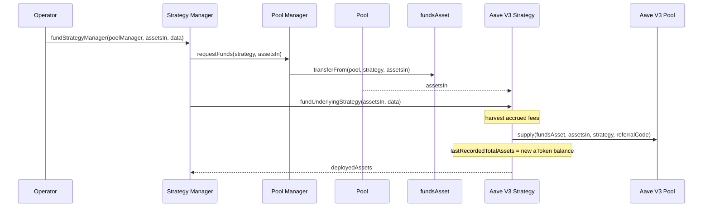
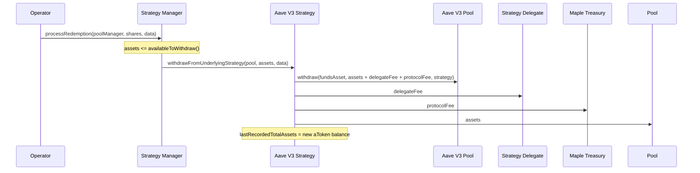

# Funding and Withdrawals

Only the [Strategy Manager](../strategy-manager.md) moves capital through the Aave V3 Strategy. This page covers the two capital flows, the rewards claim, and the operational settings around them.

## Funding

The Strategy Manager pulls assets from the Pool into the strategy and supplies them to Aave in one transaction.

`fundUnderlyingStrategy(assetsIn, data)` requires:

- the caller to be the Strategy Manager,
- `assetsIn` to be non-zero,
- `aaveToken` to still be registered in Globals as a `STRATEGY_VAULT`. Globals can delist a market after deployment to block further funding,
- no recognised loss and no pause on the function.

The function harvests accrued fees, records the aToken balance, approves the Aave pool and calls `supply()` with the stored `referralCode`. It returns `deployedAssets`, the increase in the aToken balance, rather than echoing `assetsIn`. It then sets `lastRecordedTotalAssets` to the new balance and emits `StrategyFunded(strategyManager, assetsIn, deployedAssets)`. The Strategy Manager mints shares against `deployedAssets`.

The Strategy Manager also calls this function once during `completeConfiguration()` to deploy the bootstrap deposit.

`data` is unused and reserved for future strategy-specific calldata.

## Withdrawals

Withdrawals mirror funding. The Strategy Manager redeems aTokens for the funds asset and sends the proceeds straight to the Pool.

`withdrawFromUnderlyingStrategy(destination, assets, data)` requires the caller to be the Strategy Manager and both `destination` and `assets` to be non-zero. The Strategy Manager passes the Pool as `destination` and first checks that `assets` does not exceed `availableToWithdraw()`.

A single Aave `withdraw()` call pulls the requested `assets` and any accrued fees together. The strategy pays the fees, forwards `assets` to `destination`, sets `lastRecordedTotalAssets` to the new aToken balance and emits `StrategyWithdrawal(destination, assets)`.

If the reserve cannot serve the withdrawal, Aave reverts and the whole call fails. See [the 100% utilisation revert](impairments-and-losses.md#aave-liquidity-and-the-100-utilisation-revert).

## Rewards

Aave markets may pay incentive rewards in a token separate from the funds asset. `claimRewards(assets, amount, rewardToken)` collects them.

- Callers: Strategy Delegate or Operational Admin.
- The strategy resolves the rewards controller live from `aaveToken.getIncentivesController()` and forwards the call.
- `assets` is the list of Aave tokens to check for pending rewards. `amount` is how much to claim, with `type(uint256).max` claiming everything. `rewardToken` is the token to collect.
- The full amount goes to the Maple Treasury. There is no Strategy Delegate share.
- Rewards are not part of AUM and the function remains callable after a loss is recognised.

Emits `RewardsClaimed(rewardToken, amount)`.

## Referral code

`referralCode` is the `uint16` the strategy passes on every Aave `supply()` call. The Strategy Delegate or Operational Admin can change it with `setReferralCode(uint16)`. The call reverts if the value does not change or if a loss has been recognised. It only affects future supplies.

## Metadata

`strategyMetadata` is a free-form string the contract stores but never interprets. It is set at initialization and the Strategy Delegate or Operational Admin can replace it with `setMetadata(string)`. The call reverts if the new value hashes to the current one or if a loss has been recognised.
