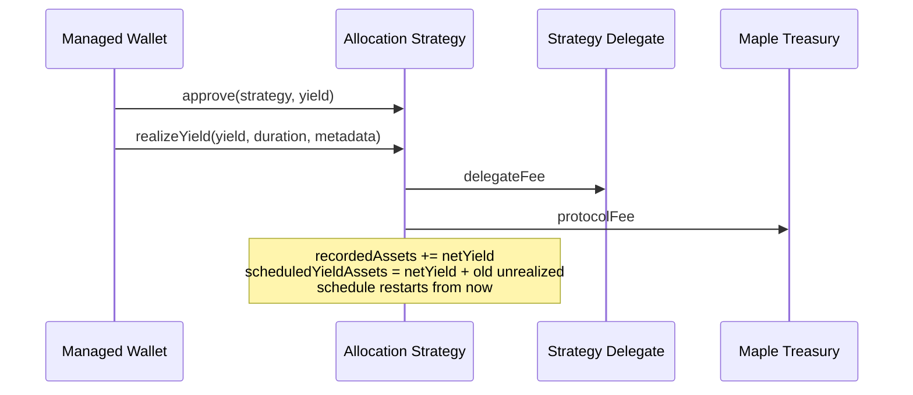

# Accounting and Fees

The Allocation Strategy accounts on a cash basis. Capital with a Managed Wallet is carried at the amount deployed, and yield only counts once the wallet has transferred it back. Returned yield then vests linearly into AUM instead of landing all at once, which blunts front-running of the Pool's share price.

## State

| Variable                   | Meaning                                                               |
| -------------------------- | --------------------------------------------------------------------- |
| `recordedAssets`           | Cash the strategy has booked. Includes yield that is still vesting.   |
| `totalDeployedAssets`      | Capital currently held by all Managed Wallets, at the amount deployed. |
| `deployedAssetsOf[wallet]` | The same, per wallet.                                                 |
| `scheduledYieldAssets`     | Net yield placed in the vesting buffer at the last `realizeYield()`.  |
| `yieldStart`, `yieldDeadline` | Start and end of the current vesting schedule.                     |
| `yieldLastRealized`        | Timestamp of the last successful `realizeYield()` call.               |
| `impairedAssets`           | Amount provisionally written down. See [Impairments and Losses](impairments-and-losses.md). |

## Views

The Strategy Manager reads two headline figures. `assetsUnderManagement()` feeds the Pool's share price. `availableToWithdraw()` caps every deployment and withdrawal.

```
assetsUnderManagement() = totalDeployedAssets + availableToWithdraw()
availableToWithdraw()   = recordedAssets - unrealizedYield()
unrealizedYield()       = scheduledYieldAssets - realizedYield()
unrecordedAssets()      = balanceOf(strategy) - recordedAssets, or 0 if the balance is lower
unrealizedLosses()      = min(impairedAssets, assetsUnderManagement())
```

| Component                                          | In `assetsUnderManagement()`?                                   |
| -------------------------------------------------- | --------------------------------------------------------------- |
| `totalDeployedAssets`                              | Yes                                                             |
| `recordedAssets` net of `unrealizedYield()`        | Yes                                                             |
| `unrealizedYield()`                                | No, until it vests                                              |
| `unrecordedAssets()`                               | No. See [skim](funding-and-withdrawals.md#skim).                |
| Fees paid on yield                                 | No. They leave before `recordedAssets` changes.                 |
| `impairedAssets`                                   | No. Reported separately through `unrealizedLosses()`.           |

## Yield vesting

`realizedYield()` is the part of `scheduledYieldAssets` that has vested so far:

```
elapsed = block.timestamp - yieldStart
total   = yieldDeadline - yieldStart

realizedYield() = scheduledYieldAssets                     if total == 0 or elapsed >= total
                = scheduledYieldAssets * elapsed / total   otherwise
```

It is zero the moment a schedule starts and reaches the full buffer at `yieldDeadline`. `unrealizedYield()` is the remainder and falls to zero on the same curve. Only the realized part counts toward `availableToWithdraw()` and AUM.

## Realizing yield

A Managed Wallet with `canRealizeYield` brings surplus in with `realizeYield(yield, duration, metadata)`, after approving the strategy on the funds asset. The call reverts unless the caller holds the permission, `yield <= yieldCap`, and `yieldCooldown() == 0`. It then:

1. Pulls `yield` from the caller, if `yield` is not zero.
2. Pays fees on `yield` and keeps `netYield` (see below).
3. Reads the current `unrealizedYield()`.
4. Adds `netYield` to `recordedAssets`.
5. Sets `scheduledYieldAssets = netYield + unrealizedYield`.
6. Sets `yieldLastRealized` and `yieldStart` to now, and `yieldDeadline` to now plus `duration`.



Every call restarts the schedule from the current block. There is one buffer and one deadline, never several in parallel. Leftover unrealized yield from the previous schedule rolls into the new one and vests again over the new `duration`.

Two zero values are valid and useful:

* `yield == 0` transfers nothing but re-schedules the existing unrealized yield over the new `duration`. This changes the pace of a buffer without adding to it.
* `duration == 0` sets `yieldDeadline` equal to `yieldStart`, which puts `realizedYield()` in its fully-realized branch. The whole buffer, old and new, lands in AUM in the same transaction.

## Fees

The strategy takes fees on the gross `yield` of each call, before anything reaches `recordedAssets`:

```
delegateFee = yield * strategyDelegateFeeRate / 1e6
protocolFee = yield * strategyProtocolFeeRate / 1e6
netYield    = yield - delegateFee - protocolFee
```

It transfers `delegateFee` to the current Strategy Delegate and `protocolFee` to the current Maple treasury, both resolved live at the time of the call, and skips a transfer when its amount is zero. Fee amounts never enter AUM. Rolled-over unrealized yield is not charged again, and changing a rate has no retroactive effect.

The Strategy Delegate sets its rate with `setStrategyDelegateFeeRate()`. The Governor or Operational Admin sets `setStrategyProtocolFeeRate()`. Each setter requires a changed value, a rate of at most `1e6`, and a sum with the other current rate of at most `1e6`. The initializer enforces the same sum.

## Yield cap

`yieldCap` is a per-call ceiling on the `yield` argument, not a cumulative limit. The Strategy Delegate or Operational Admin changes it with `setYieldCap()`, which requires a new value. A cap of `0` blocks any non-zero transfer but still allows `yield == 0` calls. The cap bounds how much a single call can add to AUM.

## Yield cooldown

`REALIZE_YIELD_COOLDOWN` is one hour. After any successful `realizeYield()`, including a zero-yield call, the next call reverts until an hour has passed. `yieldCooldown()` returns the seconds remaining. The cooldown is per strategy, not per wallet, so a call from one Managed Wallet blocks every other wallet on that strategy for the hour.

Together with the cap, the cooldown limits how fast a compromised wallet could inflate AUM by cycling deployed capital back as "yield".

## Cancelling yield

The Strategy Delegate or Security Admin can pull unvested yield back out with `cancelYield(assets, recipient)`. Passing `type(uint256).max` as `assets` cancels the entire current `unrealizedYield()`. The call reverts if the resolved amount is zero, exceeds `unrealizedYield()`, or if `recipient` is not a valid Managed Wallet on Globals.

On success the strategy subtracts the amount from `recordedAssets`, sets `scheduledYieldAssets` to the remaining unrealized amount, resets `yieldStart` to now, leaves `yieldDeadline` unchanged, and transfers the amount to `recipient`. The smaller buffer continues vesting toward the original deadline.

Only unvested yield can be cancelled. Realized yield has already merged into `recordedAssets` and is indistinguishable from other cash. Fees paid at the original `realizeYield()` are not reversed.

## Known issue: last withdrawal with active yield

If the last Pool withdraws from a strategy while yield is still vesting, the yield that vests afterwards accrues to the Strategy Manager's bootstrap shares (see [Strategy Manager](../strategy-manager.md)) and cannot be recovered. Call `cancelYield()` before the final withdrawal. See [Known Issues and Operational Controls](../../security/known-issues-and-operational-controls.md).
