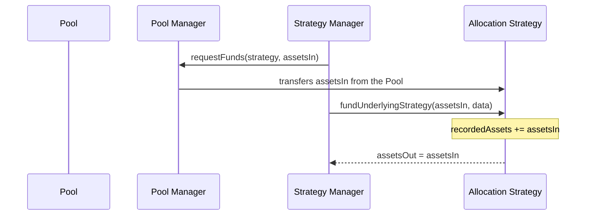
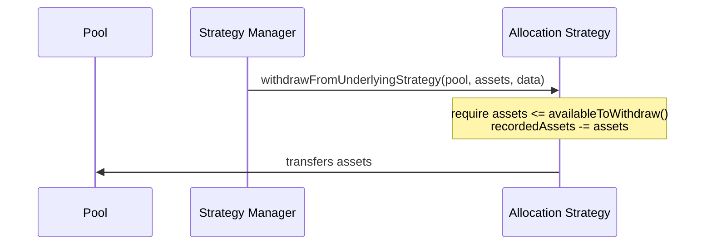

# Funding and Withdrawals

Pool capital enters and leaves the Allocation Strategy only through its Strategy Manager. Funding books cash at par, and withdrawals are limited to the cash that is neither deployed nor still vesting as yield.

## Funding

The Strategy Manager funds the strategy from `fundStrategyManager()`. The Pool Manager first transfers the assets from the Pool to the strategy through `requestFunds()`, then the Strategy Manager calls `fundUnderlyingStrategy(assetsIn, data)` on the strategy to book them.



Only the Strategy Manager can call `fundUnderlyingStrategy()`. It adds `assetsIn` to `recordedAssets` and returns the same amount, so funding is always 1:1 with no conversion and no fee on entry. The `data` argument is unused and reserved for future use. The Strategy Manager's own caps on funding are described under [Strategy Manager](../strategy-manager.md).

## Withdrawing

The Strategy Manager pulls capital back when it processes a redemption or when a Liquidity Bot moves capital elsewhere, by calling `withdrawFromUnderlyingStrategy(destination, assets, data)`.



Only the Strategy Manager can call it. The call reverts if `assets` exceeds `availableToWithdraw()`. On success the strategy subtracts `assets` from `recordedAssets` and transfers them to `destination`. Capital held by a Managed Wallet and yield still vesting are both unreachable through this path.

## Available liquidity

```
availableToWithdraw() = recordedAssets - unrealizedYield()
```

This is the only cash that `withdrawFromUnderlyingStrategy()` and `deployAssets()` may draw from. A Managed Wallet deploying capital and the Strategy Manager filling a redemption compete for the same figure, and ordinary transaction ordering decides who gets it. There is no reservation or priority between them.

`availableToWithdraw()` is lower than the contract's raw token balance in two ways:

* It excludes `unrealizedYield()`, cash that has arrived through `realizeYield()` but has not vested yet. See [Accounting and Fees](accounting-and-fees.md).
* It excludes `unrecordedAssets()`, any balance that never went through a tracked flow.

So, whenever the balance covers `recordedAssets`:

```
balanceOf(strategy) = availableToWithdraw() + unrealizedYield() + unrecordedAssets()
```

## Skim

Tokens can reach the strategy without a tracked flow, most often through a direct transfer by mistake. `unrecordedAssets()` is that surplus:

```
unrecordedAssets() = balanceOf(strategy) - recordedAssets, or 0 if the balance is lower
```

The Strategy Delegate or Operational Admin sweeps it with `skim(recipient)`. The call requires a non-zero `recipient` and a non-zero `unrecordedAssets()`, then transfers the full surplus to `recipient`. The recipient can be any address and does not need to be a Managed Wallet.

`skim()` never changes `recordedAssets`, so `assetsUnderManagement()` and `availableToWithdraw()` are unaffected. A stray transfer therefore cannot inflate the Pool's reported AUM or share price by landing in the contract. Because it only moves the surplus, `skim()` cannot reach vesting yield (inside `recordedAssets`) or deployed capital (not in the contract at all).

To bring a stray transfer back into accounting, skim it to a Managed Wallet with `canRealizeYield` and have that wallet book it with `realizeYield()`, subject to `yieldCap` and the cooldown. `returnAssets()` cannot book it, because it only accepts principal up to `deployedAssetsOf[onBehalfOf]` and reverts with `MAS:RA:EXCEEDS_ASSETS` above that. See [Realizing yield](accounting-and-fees.md#realizing-yield).
