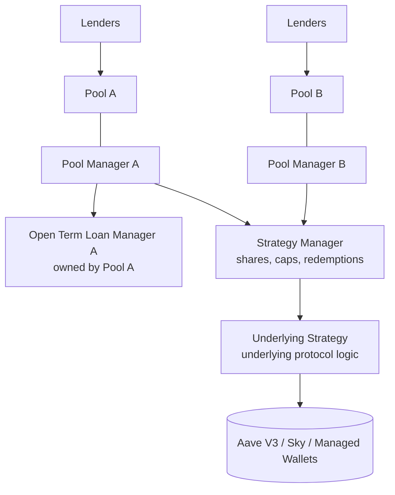
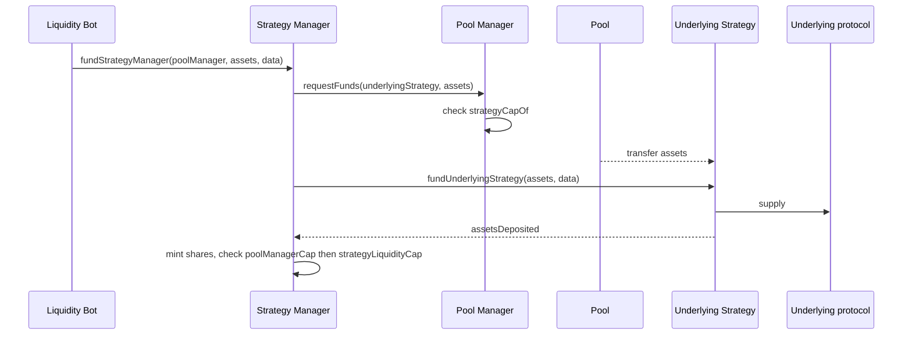
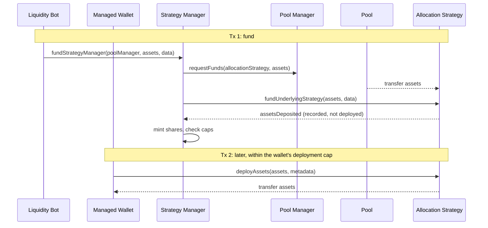
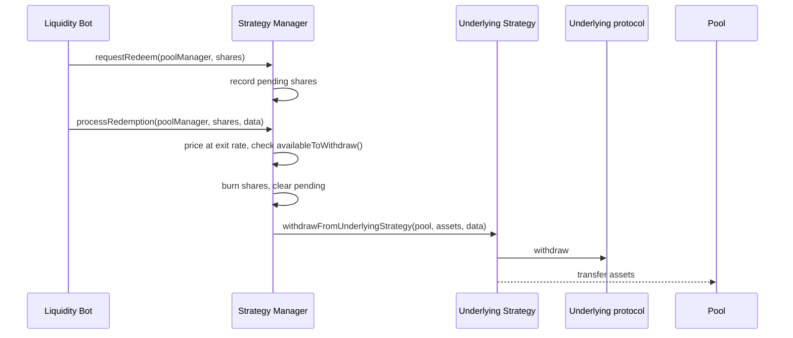
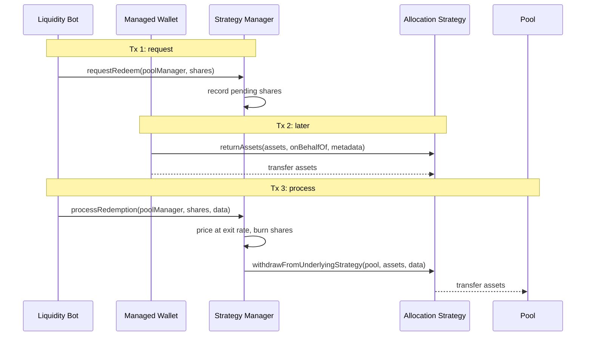

# How Pools Allocate Capital

A Pool funds open-term loans through its own Open Term Loan Manager, and shared strategies through Strategy Managers, where many Pools fund one position. This page explains how the Pool Manager treats both, the three caps that bound a shared allocation, and the flows that move capital in and out.

## Two ways to allocate

A Pool Manager keeps a single `strategyList`. Each entry is either the Pool's Open Term Loan Manager, created through `addStrategy()`, or a shared Strategy Manager attached with `addStrategyManager()`. Both call `requestFunds()` on the Pool Manager to draw capital, and both report into `totalAssets()`:

```
totalAssets() = pool asset balance
              + openTermLoanManager.assetsUnderManagement()
              + Σ strategyManager.assetsOf(poolManager) for Strategy Managers
```

`unrealizedLosses()` is built the same way, using `unrealizedLossesOf(poolManager)` for Strategy Managers. Only the Governor can attach a Strategy Manager to a configured Pool, and the Strategy Manager must support the Pool's asset. The Operational Admin can detach one with `removeStrategyManager()` once the Pool's `assetsOf()` in it is zero. Detaching also resets the Pool's cap for it to zero.



## Separation of concerns

A shared strategy is two contracts. The [Strategy Manager](strategy-manager.md) is one implementation reused for every underlying protocol. The Underlying Strategy is written per underlying protocol and knows nothing about Pools.

| Responsibility | Strategy Manager | Underlying Strategy |
| --- | --- | --- |
| Share accounting per Pool | Yes | No |
| Per-Pool value, `assetsOf(poolManager)` | Yes | No, one total only |
| Valuing the position | No, reads `assetsUnderManagement()` | Yes |
| Moving capital between Pool and underlying protocol | Yes | No |
| Talking to the underlying protocol | No | Yes |
| Redemption requests | Yes | No |
| Caps | Yes, per Pool and strategy-wide | No |
| Impairments and loss recognition | No, reads `unrealizedLosses()` | Yes |
| Fees | No | Yes |
| Holding assets | Never | Yes |

Two rules follow from this split:

1. **The Strategy Manager never holds assets.** It directs the Pool Manager to send assets straight to the Underlying Strategy, tells the Underlying Strategy to take them, then records shares for the Pool. Shares are not tokens and cannot be transferred.
2. **Pools do not push assets, the Strategy Manager pulls them.** Funding always starts with a call to `fundStrategyManager()`, and the Pool Manager releases funds only to a strategy it has attached and only within the cap it set for that strategy.

## The three caps

| Cap | Lives on | Limits | Set by |
| --- | --- | --- | --- |
| `strategyCapOf[strategy]` | Pool Manager | How much of this Pool's capital the strategy can hold, checked in `requestFunds()` before assets move | Pool Delegate, Governor or Operational Admin |
| `poolManagerCapOf[poolManager]` | Strategy Manager | How much this Pool may hold in the Strategy Manager, checked after shares are minted | Strategy Delegate or Operational Admin |
| `strategyLiquidityCap` | Strategy Manager | Total assets the Strategy Manager may hold across all Pools, checked last | Strategy Delegate or Operational Admin |

A cap on the Pool Manager defaults to zero, which blocks funding until the Pool Delegate raises it. The two caps on the Strategy Manager treat zero as unlimited. See [Caps](strategy-manager.md#caps) for the `type(uint256).max` block value.

## Funding

The Strategy Manager always ends funding by calling `fundUnderlyingStrategy()`. What happens next depends on the underlying protocol. Aave V3 and Sky deploy the assets in the same transaction. The Allocation Strategy records the assets as available and waits for a Managed Wallet to draw them down later.

### Synchronous underlying protocols (Aave V3, Sky)



### Asynchronous underlying protocol (Allocation Strategy)



## Redemptions

Leaving a strategy takes two steps. `requestRedeem()` records shares as pending without burning them. `processRedemption()` burns the shares, prices them at the exit rate net of unrealized losses, and calls `withdrawFromUnderlyingStrategy()`, which sends assets from the Underlying Strategy directly to the Pool. A pending request can be reduced with `cancelRedemption()`. Requests are tracked per Pool and are independent of the Withdrawal Manager's Lender queue.

When the underlying protocol has liquidity, both steps can run in one transaction through the [Liquidity Router](liquidity-router.md) or `multicall()`.

### Synchronous underlying protocols (Aave V3, Sky)



### Asynchronous underlying protocol (Allocation Strategy)

Processing succeeds only once the Managed Wallet has returned enough capital, because `availableToWithdraw()` counts only idle cash in the strategy.



## Actors

The Pool Delegate does not move capital. It sets limits, and the Strategy Delegate and Liquidity Bots move assets within them. Each Strategy Manager has exactly one Strategy Delegate, and a Strategy Delegate owns at most one Strategy Manager.

| Actor | Role in allocation |
| --- | --- |
| Pool Delegate | Sets `strategyCapOf` for each attached strategy. Can request and cancel redemptions for its own Pool. |
| Strategy Delegate | Sets both Strategy Manager caps. Can fund, request, cancel and process on its Strategy Manager at any time, including while the Underlying Strategy is impaired. |
| Operational Admin | Sets both Strategy Manager caps, processes redemptions, nominates a new Strategy Delegate, activates Strategy Managers in Globals and detaches them from Pools. |
| Governor | Attaches Strategy Managers to configured Pools. Can also activate them in Globals and set `strategyCapOf`. |
| Liquidity Bot | Funds, requests, cancels and processes on behalf of Pools, directly or through the Liquidity Router. Blocked while the Underlying Strategy has impaired assets. |
| Managed Wallet | Draws capital from and returns it to an Allocation Strategy. See [Managed Wallets](allocation-strategy/managed-wallets.md). |

For the complete list of protocol roles see [Protocol Actors](../protocol-overview/protocol-actors.md).
