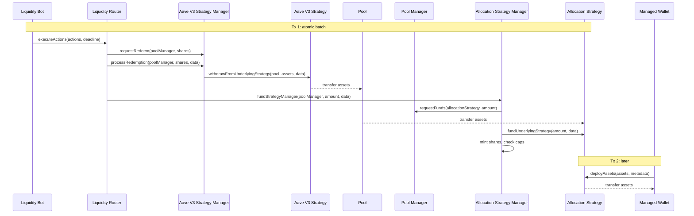
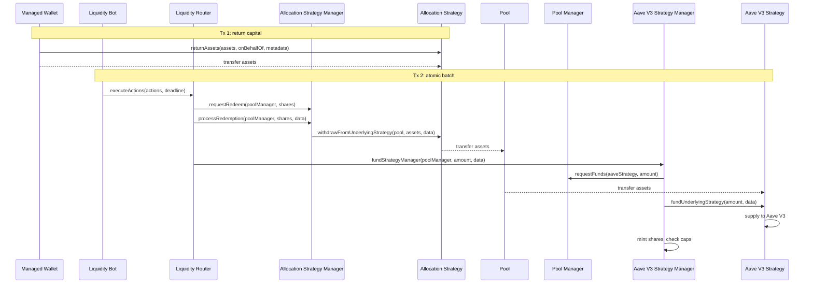

# Liquidity Router

`MapleLiquidityRouter` lets a registered Liquidity Bot move capital between strategies in one atomic transaction. The bot builds an ordered list of funding and redemption actions off-chain and submits it. The router checks the caller and each Strategy Manager, then executes the actions in order. If any action fails, the whole batch reverts. The function reference is on the [LiquidityRouter interface page](../interfaces/liquidity-router.md).

The router does not decide how to allocate capital, compute amounts, hold assets, or bypass any check in the Pool Manager, Strategy Manager or Underlying Strategy.

## Actors

| Actor | Role |
| --- | --- |
| Liquidity Bot | Builds the batch and calls `executeActions()`. |
| Liquidity Router | Validates and executes the batch in order. |
| Pool Manager | Releases Pool assets to the Underlying Strategy within `strategyCapOf`. |
| Strategy Manager | Mints and burns shares, enforces its caps and the redemption queue. |
| Underlying Strategy | Deploys capital and returns it on redemption. |
| Managed Wallet | Draws and returns Allocation Strategy capital outside router batches. |

## Permissions

The router is a plain contract, not a proxy, and stores an immutable `globals` address. Two Globals keys govern it, both checked live on every call:

| Key | Holder | Checked by |
| --- | --- | --- |
| `LIQUIDITY_ROUTER_BOT` | The bot calling the router | `executeActions()` |
| `LIQUIDITY_ROUTER` | The router itself | Each Strategy Manager's Operator check |

Granting or revoking either key takes effect immediately. A bot registered only as `LIQUIDITY_BOT` can call Strategy Managers directly but cannot use the router.

`executeActions()` reverts while paused in Globals, and each Strategy Manager applies its own pause check. Because the router acts as an Operator, a Strategy Manager rejects it whenever the Underlying Strategy has impaired assets. See [Access control](strategy-manager.md#access-control).

## Actions

```solidity
function executeActions(Action[] calldata actions, uint256 deadline) external;

struct Action {
    ActionType actionType;
    address    strategyManager;
    address    poolManager;
    uint256    amount;
    bytes      strategyData;
}
```

| `ActionType` | Strategy Manager call | `amount` |
| --- | --- | --- |
| `FUND_STRATEGY` | `fundStrategyManager(poolManager, amount, strategyData)` | Assets |
| `REQUEST_REDEEM` | `requestRedeem(poolManager, amount)` | Shares |
| `CANCEL_REDEMPTION` | `cancelRedemption(poolManager, amount)` | Shares |
| `PROCESS_REDEMPTION` | `processRedemption(poolManager, amount, strategyData)` | Shares |

`strategyData` is forwarded to the Underlying Strategy on funding and processing and ignored otherwise. The bot computes `amount` off-chain, using `convertToExitShares()` on the Strategy Manager when it needs shares for a target amount of assets.

## Batch validation

Before the loop, the router requires that the caller holds `LIQUIDITY_ROUTER_BOT`, `block.timestamp <= deadline`, and the batch is not empty.

For each action it requires that `strategyManager` and `poolManager` are non-zero, that the Strategy Manager's `factory()` is a registered `STRATEGY_MANAGER_FACTORY`, and that the Strategy Manager is an instance of that factory. It then makes the call from the table above and emits `ActionExecuted(actionIndex, actionType, strategyManager, poolManager, amount)`.

Everything else is enforced downstream: Pool Manager validity, caps, available liquidity, share balances, pause state and impairment. Actions run in the exact order supplied, so assets returned to a Pool by one action can fund a later action in the same transaction.

## Rebalancing examples

### Aave V3 to an Allocation Strategy

One batch requests and processes a redemption from the Aave V3 Strategy Manager, then funds the Allocation Strategy Manager from the same Pool. A Managed Wallet draws the capital down later.



### Allocation Strategy to Aave V3

The Managed Wallet first returns capital to the Allocation Strategy. The bot then runs one batch that redeems from the Allocation Strategy Manager and funds the Aave V3 Strategy Manager.


