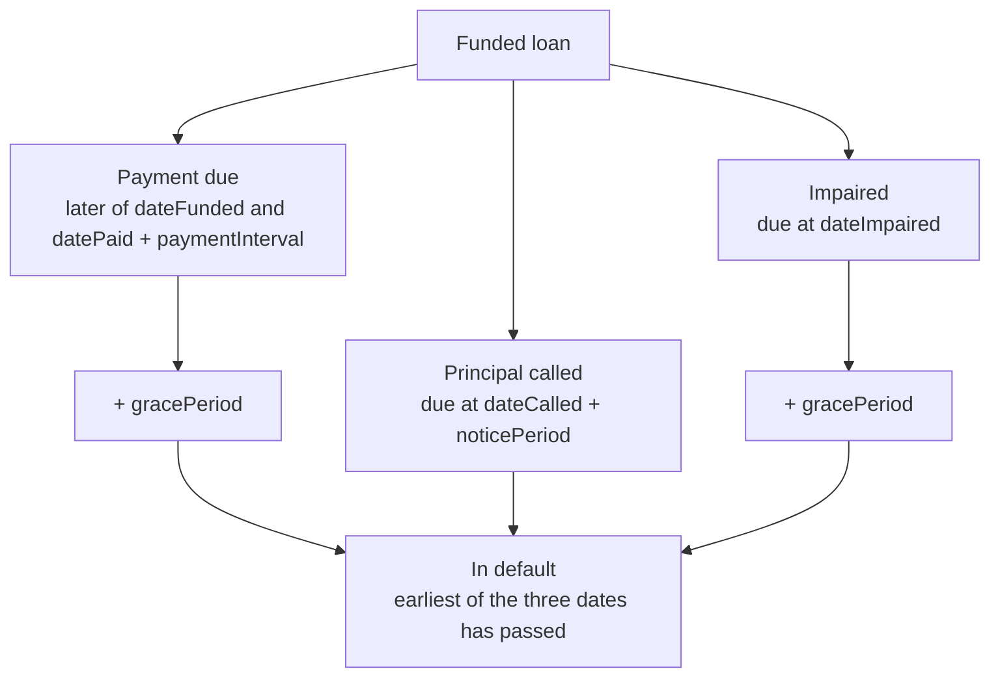

# Defaults

Whenever a Borrower is no longer able to meet their obligations, the Pool Delegate, Governor or Operational Admin have the option to trigger a default by calling `triggerDefault()` on the PoolManager. This process realizes the Loan's losses and adjusts the Pool accounting accordingly.

Every Loan has a defined payment interval which determines when payments are expected to be made by the Borrower. If the Borrower does not make a payment before the expected due date, there is a grace period during which they can make a late payment. After the grace period passes the loan is considered to be in default, and the Pool Delegate, Governor or Operational Admin has the option to trigger the default. The Loan enforces this: `repossess` reverts with `ML:R:NOT_IN_DEFAULT` unless `isInDefault()` is true, meaning the current time is past the loan's `defaultDate()`.

A call or an impairment can bring the default date forward. `defaultDate()` is the earliest of three dates: the normal payment due date plus `gracePeriod`, `dateCalled` plus `noticePeriod` with no grace period, and `dateImpaired` plus `gracePeriod`. A payment that satisfies the call or clears the impairment returns the loan to the normal path.

These paths are illustrated in the diagram below.



Open-term loans hold no collateral, so a default completes atomically in a single transaction. The Pool Manager calls `triggerDefault(loan, address(0))` on the Open Term Loan Manager, which records an impairment in its own accounting first if the loan is not already impaired, so the accounting always starts from the impaired state.

## Loss Accounting

When a Loan is defaulted, the losses must be recognized in the Pool's accounting. This happens in the following steps:
1. Decrease `principalOut` by the full outstanding principal of the Loan. This will decrease `totalAssets` by the same amount.
2. Accrue all Loans' interest to the current timestamp and remove all interest that has accrued against the defaulted loan. This will reduce `totalAssets` by the full outstanding interest amount in the defaulted Loan.

The remaining losses are represented to LPs as a decrease in `totalAssets`. The below example will illustrate how this affects accounting in practice.

```
## Starting State

principalOut        = 10_000
outstandingInterest =    200
cash                =  3_000
unrealizedLosses    =      0

totalAssets = 10_000 + 200 + 3_000
            = 13_200

loan principal = 4_000
loan interest  =   100

## After Default

principalOut        = 6_000
outstandingInterest =   100
cash                = 3_000
unrealizedLosses    =     0

totalAssets = 6_000 + 100 + 3_000
            = 9_100
```

## Fund Recovery

When a loan is defaulted, any funds that can be recovered from the loan contract are repossessed. The protocol enforces an order to which the funds will be directed: recovered funds first go towards fees owed to the protocol (platform service and management fees), then to the Pool up to the outstanding principal and net interest, and anything left over returns to the Borrower. The Pool Delegate does not recover any fees owed during a Loan default. The Loan Manager reports the unrecovered principal and interest to the Pool Manager, which emits it in `CollateralLiquidationFinished`.
