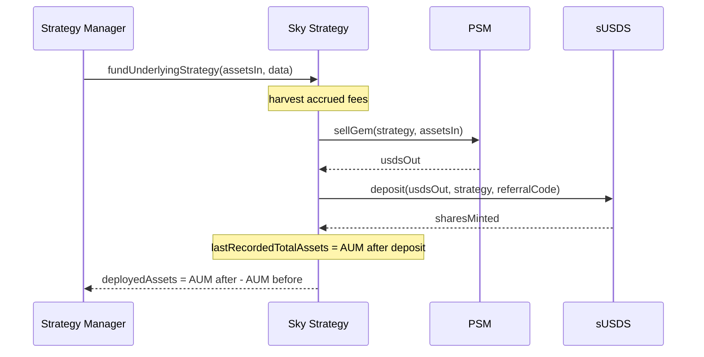
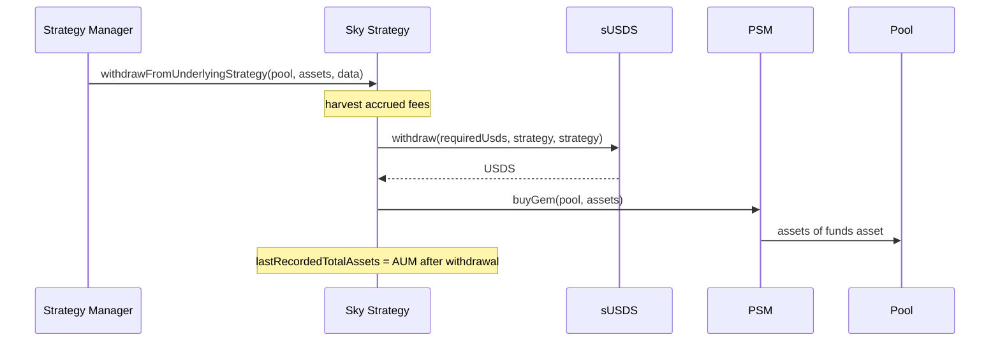

# Funding and Withdrawals

Only the bound [Strategy Manager](../strategy-manager.md) moves capital into or out of the Sky Strategy. Every movement passes through the PSM in one direction or the other, and every movement first harvests outstanding fees as described in [Accounting and Fees](accounting-and-fees.md#fee-accrual).

## Funding

The Strategy Manager calls `fundUnderlyingStrategy(assetsIn, data)` after the Pool has transferred `assetsIn` of the funds asset to the strategy. The call reverts unless:

- `assetsIn` is non-zero.
- `savingsUsds` is still a registered `STRATEGY_VAULT` instance and `psm` a registered `PSM` instance on Globals. The initializer checks these once, funding re-checks them every time.
- `psm.tout()` is not `type(uint256).max`.

The strategy then approves the PSM and calls `sellGem()`, approves sUSDS for the USDS it received and calls `deposit()` with the stored `referralCode`. It returns `deployedAssets`, the change in `currentTotalAssets` across the deposit, rather than echoing `assetsIn`. The difference between the two is the PSM's entry fee (`tin`), the exit fee already deducted in the valuation (`tout`) and any rounding in the USDS to sUSDS round trip. The Strategy Manager mints Pool shares against `deployedAssets`, so each Pool bears the PSM fees on its own deposit. It emits `StrategyFunded(strategyManager, assetsIn, sharesMinted, deployedAssets)`.

`data` is unused and reserved for future calldata.

## Withdrawals

The Strategy Manager calls `withdrawFromUnderlyingStrategy(destination, assets, data)` when it processes a redemption, passing the redeeming Pool as `destination`. Both `destination` and `assets` must be non-zero. The Strategy Manager has already checked that `assets` does not exceed `availableToWithdraw()`.

The strategy computes the USDS needed at the live `tout`, `assets * to18ConversionFactor * (1 + tout)`, withdraws exactly that much USDS from sUSDS, approves the PSM and calls `buyGem(destination, assets)`. The destination receives exactly `assets`. Because AUM already values the position net of `tout`, paying the exit fee does not change the value of the shares that remain. The call emits `StrategyWithdrawal(destination, sharesBurned, assets)`.

## When the PSM is halted

Sky can halt either side of the PSM by setting the relevant fee to `type(uint256).max`. The strategy behaves as follows:

| Condition | Effect |
|---|---|
| `tout == max` (`buyGem()` halted) | `fundUnderlyingStrategy()` reverts with `MSS:FUS:PSM_HALTED`. `availableToWithdraw()` returns `0`, so the Strategy Manager does not process redemptions. Any attempt to withdraw or to harvest a non-zero fee reverts, because both need `buyGem()`. `assetsUnderManagement()` keeps reporting the position using [`fallbackTout`](accounting-and-fees.md#fallback-tout). |
| `tin == max` (`sellGem()` halted) | The strategy does not check `tin`. `fundUnderlyingStrategy()` reverts inside the PSM's `sellGem()`. Valuation, withdrawals and fee collection are unaffected. |

The strategy has no state of its own to unwind after a halt. Once Sky restores the fees, funding and withdrawals resume without any admin action.

## Referral code

sUSDS `deposit()` takes a Sky referral code as its last argument. The strategy passes the stored `referralCode` on every deposit. The Strategy Delegate or Operational Admin can change it with `setReferralCode(referralCode)`, which requires a different value and emits `ReferralCodeSet`. It only affects future deposits.

## Metadata

`strategyMetadata` is a free-text string stored for off-chain tooling. The contract does not interpret it. The Strategy Delegate or Operational Admin updates it with `setMetadata(metadata)`, which reverts if the new string hashes to the same value as the current one.

## Multicall

`multicall(data)` executes each entry of `data` as a `delegatecall` into the strategy itself and reverts with the inner error if any entry fails. It has no access control of its own because a `delegatecall` preserves `msg.sender`, so every batched function still checks the original caller. An unauthorized caller gains nothing by routing a privileged call through `multicall()`. It lets an EOA batch admin calls, for example `impair()` and `setReferralCode()`, in one transaction.
