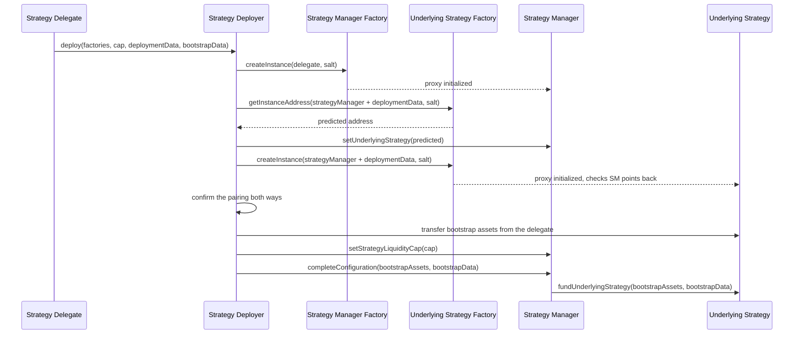

# Strategy Deployer

`MapleStrategyDeployer` creates a shared strategy in one transaction: it deploys a Strategy Manager and its Underlying Strategy, links them to each other, seeds the position and marks the manager configured. It exists so the two contracts, which each need the other's address at initialization, can never be left half wired. The function reference is on the [StrategyDeployer interface page](../interfaces/strategy-deployer.md).

## Proxy factories

Both contracts are proxies created by a `MapleProxyFactory`. `createInstance(arguments, salt)` deploys the proxy with CREATE2 and runs its initializer, so the address is fixed by the arguments and the salt, and `getInstanceAddress(arguments, salt)` returns it before deployment. The deployer relies on this to tell the Strategy Manager where its Underlying Strategy will live before that contract exists.

Two factories take part: `MapleStrategyManagerFactory`, registered in Globals as `STRATEGY_MANAGER_FACTORY`, and one factory per underlying protocol (Aave V3, Sky, Allocation), each registered as `UNDERLYING_STRATEGY_FACTORY`. Each factory's `createInstance()` requires `globals.canDeploy(msg.sender)`, so the deployer must be allowed to deploy from both factories through `setCanDeployFrom()`.

## Strategy Delegate

The caller of `deploy()` becomes the new Strategy Manager's Strategy Delegate and must already be a valid Strategy Delegate in Globals. The deployer derives the CREATE2 salt from the delegate's address, so `getDeploymentAddresses(strategyDelegate, factories, deploymentData)` predicts both addresses for a given delegate ahead of time.

## Bootstrap mint

Globals holds `bootstrapMint(asset)`, an amount per funds asset set by the Governor or Operational Admin. If it is non-zero for the Underlying Strategy's `fundsAsset()`, the deployer transfers that amount from the Strategy Delegate, who must have approved the deployer, directly into the Underlying Strategy. `completeConfiguration()` then deploys it into the underlying protocol and records the shares against `address(0)`. If the amount is zero the step is skipped and the Strategy Manager starts with no shares. See [Bootstrap deposit](strategy-manager.md#bootstrap-deposit) for why the seed is permanent.

## Deployment flow

`deploy(strategyManagerFactory, strategyFactory, strategyLiquidityCap, strategyDeploymentData, bootstrapFundingData)` performs nine steps atomically:

1. **Validate.** The caller is a valid Strategy Delegate, and both factories carry the expected Globals keys.
2. **Deploy the Strategy Manager** through its factory with the delegate as the only initializer argument.
3. **Predict the Underlying Strategy's address** from the Underlying Strategy's factory, using the Strategy Manager's address prepended to `strategyDeploymentData`.
4. **Set the predicted address** on the Strategy Manager with `setUnderlyingStrategy()`. The Underlying Strategy's initializer reverts unless this is already in place.
5. **Deploy the Underlying Strategy** through the Underlying Strategy's factory. Its initializer runs the underlying protocol checks and confirms the Strategy Manager points back at it.
6. **Confirm the pairing.** `strategyManager.underlyingStrategy()` must equal the deployed address and `underlyingStrategy.strategyManager()` must equal the Strategy Manager.
7. **Transfer the bootstrap assets** from the delegate to the Underlying Strategy, if Globals defines an amount for the asset.
8. **Set `strategyLiquidityCap`** if the delegate supplied a non-zero value. Zero leaves it unset for an admin to set later.
9. **Complete configuration.** The Strategy Manager funds the bootstrap assets into the underlying protocol, records the seed shares and sets `configured = true`.

`deploy()` emits `StrategyManagerDeployed(strategyDelegate, strategyManager, underlyingStrategy)` and returns both addresses.

## After deployment

The new Strategy Manager is wired and seeded but cannot move Pool capital yet. Three more steps follow, each by a different actor.

| Step | Contract | Function | Caller |
| --- | --- | --- | --- |
| Activate the Strategy Manager | Globals | `activateStrategyManager()` | Governor or Operational Admin |
| Attach it to a Pool | Pool Manager | `addStrategyManager()` | Governor |
| Set the Pool's cap for it | Pool Manager | `setStrategyCap()` | Pool Delegate, Governor or Operational Admin |

Funding reverts until the manager is active, and a Pool can fund it only after attaching it and raising `strategyCapOf` above its default of zero. See [Activation](strategy-manager.md#activation) and [The three caps](how-pools-allocate-capital.md#the-three-caps).
