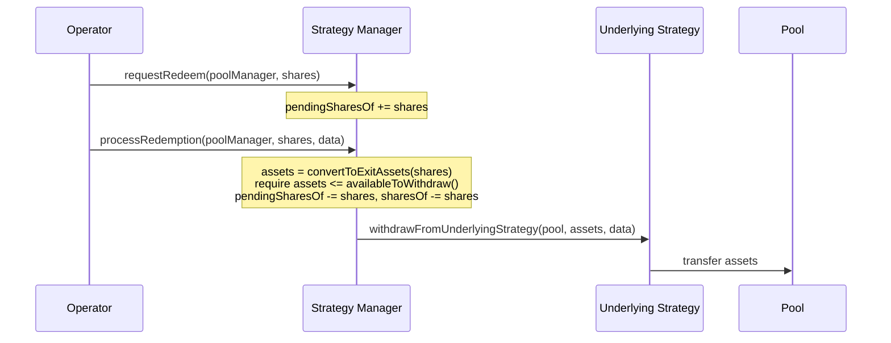
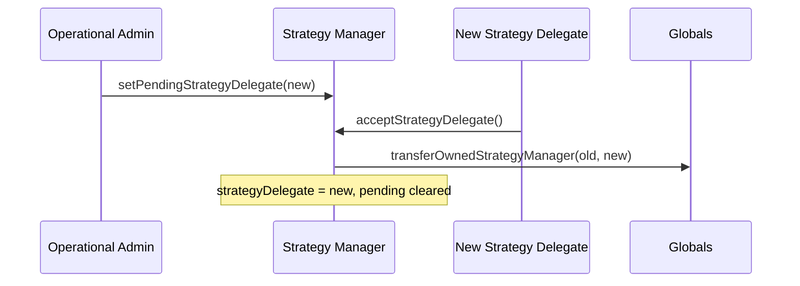

# Strategy Manager

`MapleStrategyManager` sits between any number of Pools and one Underlying Strategy. It tracks each Pool's share of the shared position, caps how much each Pool and the strategy as a whole can hold, and runs the redemption queue. It never holds assets itself. The function reference is on the [StrategyManager interface page](../interfaces/strategy-manager.md).

## Initialization

A Strategy Manager is an upgradeable proxy created by `MapleStrategyManagerFactory`. Its initializer takes one parameter, `strategyDelegate`, which must be non-zero and registered as a Strategy Delegate in Globals. Everything else is set in the same transaction by the [Strategy Deployer](strategy-deployer.md):

1. `setUnderlyingStrategy()` stores the Underlying Strategy's address, predicted before that contract exists.
2. `setStrategyLiquidityCap()` sets the strategy-wide cap if the Strategy Delegate supplied one.
3. `completeConfiguration()` funds the bootstrap deposit, if any, and sets `configured = true`.

Once `configured` is true, `setUnderlyingStrategy()` and `completeConfiguration()` are locked for the life of the contract.

### Bootstrap deposit

If `bootstrapAssets` is non-zero, `completeConfiguration()` calls `fundUnderlyingStrategy()` with it and records the resulting shares against `address(0)`:

```
sharesOf[address(0)] = assetsDeposited
totalShares          = assetsDeposited
```

Nobody can act for `address(0)`, so these shares are never redeemed. They keep `totalShares` non-zero before the first Pool funds the strategy, which protects Pools against share-price manipulation. The bootstrap deposit is not checked against any cap.

## Activation

A configured Strategy Manager still rejects `fundStrategyManager()` until `active` is true. Only Globals can call `setActive()`, and Globals does so from `activateStrategyManager()` (Governor or Operational Admin), which checks that:

- the Strategy Manager's factory is a registered `STRATEGY_MANAGER_FACTORY` and the manager is an instance of it,
- `strategyDelegate()` is a valid Strategy Delegate,
- that delegate does not already own a Strategy Manager.

Globals then records `ownedStrategyManager` for the delegate and sets the manager active. One Strategy Delegate owns at most one Strategy Manager.

## Access control

The Strategy Delegate and Maple's Liquidity Bots operate the Strategy Manager. In the table below, **Operator** means the Strategy Delegate, an address registered in Globals as `LIQUIDITY_BOT`, or the Liquidity Router (`LIQUIDITY_ROUTER`). Bots and the Liquidity Router stop as soon as the Underlying Strategy reports an impairment, but the Strategy Delegate does not. See [Liquidity Bot Actions](../admin-functions/liquidity-bot-actions.md#the-impairment-block) for the details.

| Function | Allowed callers |
| --- | --- |
| `setUnderlyingStrategy`, `completeConfiguration` | Anyone before configuration, nobody after |
| `setStrategyLiquidityCap`, `setPoolManagerCap` | Anyone before configuration, then Strategy Delegate or Operational Admin |
| `setActive` | Globals |
| `fundStrategyManager` | Operator |
| `requestRedeem`, `cancelRedemption` | Operator, or the Pool Delegate of the target Pool Manager |
| `processRedemption` | Operator or Operational Admin |
| `setPendingStrategyDelegate` | Operational Admin |
| `acceptStrategyDelegate` | The pending Strategy Delegate |
| `multicall` | Anyone. Each inner call runs its own checks against the original caller. |
| `migrate`, `setImplementation` | Factory |
| `upgrade` | Security Admin |

Every state-changing function except `multicall()` also reverts while paused in Globals.

## Multicall

`multicall(bytes[] data)` delegatecalls each entry back into the contract and reverts the whole batch with the first inner error. It has no access, pause or reentrancy check of its own. Each inner call runs its own checks against the original caller.

## Accounting

Every asset figure is a live read of the Underlying Strategy:

```
assetsUnderManagement() = underlyingStrategy.assetsUnderManagement()
availableToWithdraw()   = underlyingStrategy.availableToWithdraw()
unrealizedLosses()      = min(underlyingStrategy.unrealizedLosses(), assetsUnderManagement())
```

Shares divide that single figure among Pools, and each Pool Manager reads its own slice:

```
assetsOf(poolManager)           = sharesOf[poolManager] * assetsUnderManagement() / totalShares
unrealizedLossesOf(poolManager) = ceil(sharesOf[poolManager] * unrealizedLosses() / totalShares)
```

When `totalShares` is zero, every conversion returns its input one to one.

### Exit conversions

Redemptions settle at the exit rate, which removes unrealized losses from the numerator. A Pool that exits while the strategy carries an impairment takes its share of that loss:

```
convertToExitAssets(shares) = shares * (assetsUnderManagement() - unrealizedLosses()) / totalShares
convertToExitShares(assets) = ceil(assets * totalShares / (assetsUnderManagement() - unrealizedLosses()))
```

`convertToExitShares()` previews the shares needed for a target amount of assets. It rounds up, so callers should clamp the result to the Pool's share balance.

### Rounding

| Used by | Conversion | Rounds |
| --- | --- | --- |
| `fundStrategyManager`, `convertToShares` | assets to shares | Down |
| `assetsOf`, `convertToAssets` | shares to assets | Down |
| `processRedemption`, `convertToExitAssets` | shares to exit assets | Down |
| `convertToExitShares` | assets to exit shares | Up |
| `unrealizedLossesOf` | pro-rata loss | Up |

Conversions that move value round down, so remainders stay in the position for all shareholders. `unrealizedLossesOf()` rounds up so a Pool's reported loss exposure is never understated.

## Funding

`fundStrategyManager(poolManager, assetsIn, data)` runs these checks and steps in order:

1. `active` is true and `assetsIn` is non-zero.
2. `poolManager` is an instance of a registered `POOL_MANAGER_FACTORY`, and the Underlying Strategy is an instance of a registered `UNDERLYING_STRATEGY_FACTORY`.
3. Records `assetsUnderManagement()` before the deposit, so new capital does not dilute its own price.
4. Calls `poolManager.requestFunds(underlyingStrategy, assetsIn)`. The Pool Manager checks its own `strategyCapOf` and transfers assets from the Pool to the Underlying Strategy.
5. Calls `fundUnderlyingStrategy(assetsIn, data)`, which returns `assetsDeposited`. This can differ from `assetsIn`, for example after an underlying protocol fee.
6. Mints `convertToShares(assetsDeposited)` against the pre-deposit total. Zero shares reverts.
7. Checks `poolManagerCapOf`, then `strategyLiquidityCap`.

A cap breach reverts the whole transaction, including the deposit into the underlying protocol. Once a loss is recognized, the Aave V3 and Sky strategies revert step 5 with `MAV3S:LOSS_RECOGNIZED` and `MSS:LOSS_RECOGNIZED`, so the Strategy Manager cannot be funded again. The Allocation Strategy has no such check. If its `assetsUnderManagement()` falls to zero while shares remain, for example after a recognized loss, step 6 divides by zero and funding reverts.

## Redemptions

Exiting is split into deciding and settling. A Pool Delegate can queue an exit on its own, and the funds move only when an Operator or the Operational Admin processes it against real liquidity.

**Request.** `requestRedeem(poolManager, shares)` adds to `pendingSharesOf[poolManager]` and `totalPendingShares`. `shares` must be non-zero and at most `sharesOf - pendingSharesOf`. Share balances do not change.

**Cancel.** `cancelRedemption(poolManager, shares)` reverses part or all of a pending request. `shares` must be non-zero and at most `pendingSharesOf[poolManager]`.

**Process.** `processRedemption(poolManager, shares, data)` requires `shares` to be non-zero and at most the pending amount, so only requested shares can be processed and partial processing is allowed. It prices the shares with `convertToExitAssets()`, requires the result to be non-zero and at most `availableToWithdraw()`, reduces both `pendingSharesOf` and `sharesOf`, then calls `withdrawFromUnderlyingStrategy(pool, assets, data)`. The Underlying Strategy sends assets straight to the Pool.



The two steps may run back to back in one transaction, through `multicall()` or the [Liquidity Router](liquidity-router.md), when the underlying protocol has the liquidity.

## Caps

`strategyLiquidityCap` bounds `assetsUnderManagement()` across all Pools. It is a hard limit with no special values, so zero blocks all funding. The [Strategy Deployer](strategy-deployer.md) sets it only when given a non-zero value.

`poolManagerCapOf[poolManager]` bounds `assetsOf(poolManager)`, measured against live value rather than cumulative deposits, so it frees up as the Pool redeems or absorbs a loss. It has three states:

- `0`: no cap, the Pool is limited only by `strategyLiquidityCap`.
- Any other value: `assetsOf(poolManager)` must not exceed it after funding.
- `type(uint256).max`: the Pool is blocked from funding entirely.

A non-zero `poolManagerCapOf` requires a valid Pool Manager, and both setters revert if the value is unchanged. The third cap, on the Pool Manager, is described in [How Pools Allocate Capital](how-pools-allocate-capital.md#the-three-caps).

## Strategy Delegate handover

The Operational Admin nominates the successor and the successor must accept, so a handover cannot complete from one key alone.



`setPendingStrategyDelegate()` overwrites any existing nomination, and `address(0)` cancels it. `acceptStrategyDelegate()` calls Globals, which requires that the current delegate owns this Strategy Manager (so the manager must already be activated), that the new delegate is a valid Strategy Delegate, and that the new delegate owns no other Strategy Manager.

